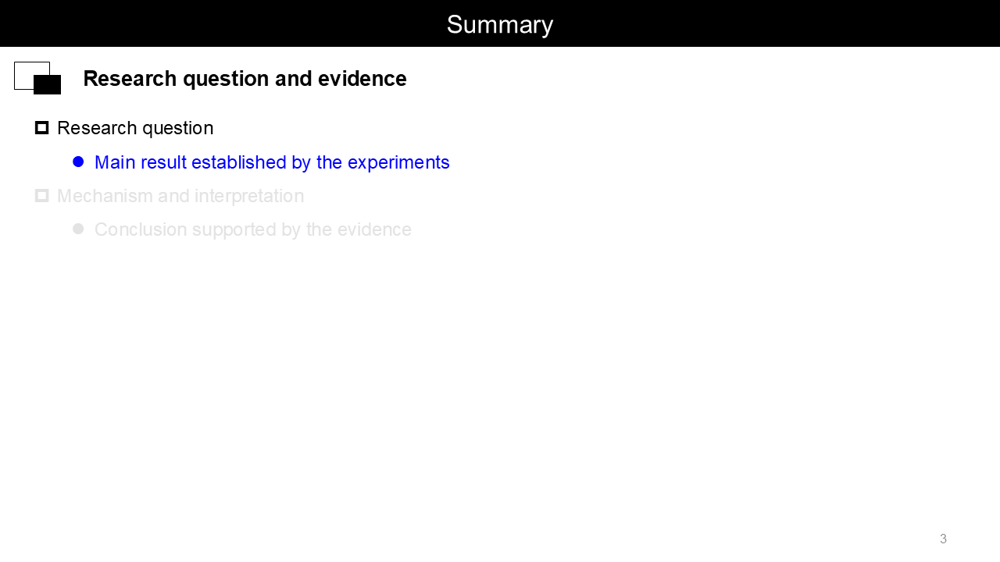

# Journal Club PPT

从论文标题、DOI、链接或 PDF 制作完整的组会 Journal Club PowerPoint。默认英文页面、中文正式讲稿，正文以论文原图为主，采用黑色标题栏、蓝色强调与紧凑的阶段性 Summary。

## 使用

安装后向 Codex 发送论文标题即可，例如

> 使用 $journal-club-ppt，为《论文标题》制作完整的组会 JC PPT，保存到我指定的文件夹。

Codex 会定位正式版本，获取可访问的正文、主图和必要补充材料，按实验逻辑拆页，补充通讯作者和研究背景，并生成演讲者备注。获取不到必要材料时，会请你提供相应的 PDF 或图片。

默认覆盖全部主图，必要附图直接放进对应论证位置。标题、Summary、正文和页码均为原生形状内文字。图片嵌入 PPTX，来源资料另存项目目录。风格细节见 [样式规范](references/style.md)。

## 安装

将这段提示词发送给目标电脑上的 Codex

> 从 https://github.com/zhang-mengjia/journal-club-ppt 安装 journal-club-ppt skill。仓库根目录就是 skill，将整个仓库安装到 CODEX_HOME/skills，未设置 CODEX_HOME 时使用用户主目录的 .codex/skills。保留 scripts、references、assets 的相对结构。先检查同名目录与本地修改，安装后验证 SKILL.md 和内部引用，并检查可用的 PPTX 运行时、PyMuPDF、Pillow 与渲染工具。

也可以使用 Git 克隆到 Codex 的 skills 目录，目录名保持 `journal-club-ppt`。安装后重新打开 Codex 会话。

## 运行环境

skill 的检索、精读和内容组织由 Codex 完成。随包构建器使用 Codex Artifact Tool JavaScript 运行时，通过 `load_workspace_dependencies` 查找，再设置 `RUNTIME_NODE_MODULES`。Python 的 PDF 与图片准备工具分别使用 PyMuPDF 和 Pillow。字体默认 Arial，字体文件和运行时由目标机器提供。

Windows 可用已安装的 PowerPoint 逐页渲染。其他平台可使用可用的演示文稿渲染器或 LibreOffice，并逐页检查排版。可在用户指定的其他 PPTX 工具中按同一版式制作。

| 文件 | 用途 |
| --- | --- |
| [SKILL.md](SKILL.md) | Codex 工作流与默认要求 |
| [assets/jc-reference.pptx](assets/jc-reference.pptx) | 可分发的空白样式参考 |
| [references/plan.md](references/plan.md) | 逐页计划格式和构建方法 |
| [scripts/](scripts/) | 素材处理、PPTX 构建、原生文字整理、检查和渲染 |

仓库分发通用版式、说明和代码。实际论文、论文图片、作者肖像和用户项目资料保存在执行任务的本地项目中，遵循各自来源的使用条件。

2026-11-18 使用《Subspace communication in the hippocampal–retrosplenial axis》完成从题名检索到 PPTX 的本地实测。成稿为 35 页，覆盖 5 张主图的全部 28 个 panel，并按逻辑加入必要附图，35 页均含正式中文讲稿并完成 PowerPoint 逐页渲染检查。正文采用公开作者稿全文，主图与所用附图采用出版社正式图，编号对应关系保存在本地测试项目。

代码与通用模板采用 MIT 许可证。
